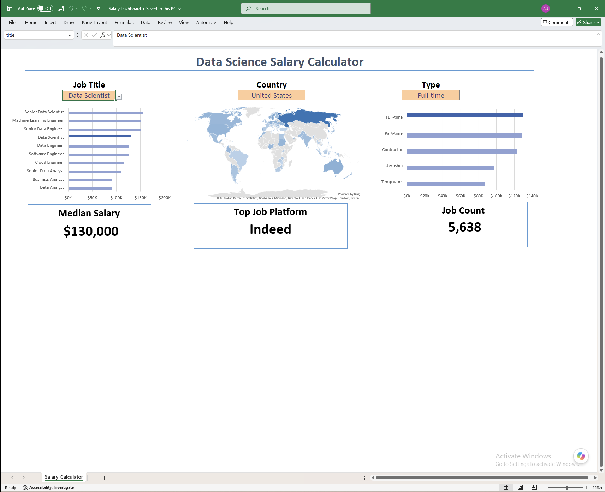

# Excel Salary Dashboard

An interactive Excel dashboard that answers one question fast: **what should this job actually pay?** Pick a job title, country, and employment type and every chart and KPI card updates instantly — no PivotTables, no VBA, no Power Query. Just structured references and dynamic array formulas doing the work live.

## Overview

This dashboard lets job seekers benchmark compensation across data roles (Data Analyst, Data Scientist, Data Engineer, Machine Learning Engineer, and six other titles) without digging through scattered job postings one at a time. Select a Job Title, Country, and Type from the dropdowns; the salary-by-title chart, the country map, the employment-type chart, and the three KPI cards (Median Salary, Top Job Platform, Job Count) all recalculate off that single selection.

## Dataset

- **Source:** Job postings dataset provided in Luke Barousse's Data Analyst course
- **Size:** 32,672 postings, 16 fields (title, location, platform, schedule type, remote flag, degree requirement, health insurance, country, salary rate/year/hour, company, required skills)
- **Coverage note:** only 22,036 of the 32,672 postings (67%) actually disclose a salary — worth knowing before treating any salary figure from this kind of dataset as gospel

## Features

- **Job Title filter** — dropdown covering Data Analyst, Data Scientist, Data Engineer, Senior variants, Business Analyst, Software Engineer, ML Engineer, Cloud Engineer
- **Country filter** — narrows every chart and KPI to one country, with a native Excel Region Map (Bing-powered) highlighting posting density
- **Employment Type filter** — Full-time, Part-time, Contractor, Temp work, Internship
- **Salary-by-title chart** — horizontal bar chart ranking median salary across roles, with the currently selected title highlighted in a different color
- **Job-type volume chart** — bar chart of posting counts by employment type
- **KPI cards** — Median Salary, Top Job Platform, and Job Count, all driven by the current filter selection

## Tools & Techniques Demonstrated

This was built entirely with formulas — deliberately, to force fluency with the array-formula toolkit rather than leaning on PivotTables:

- **Excel Table + structured references** (`jobs[salary_year_avg]`, `jobs[job_country]`, etc.) as the single source of truth for all downstream formulas
- **Dynamic arrays** — `UNIQUE`, `SORT`, `FILTER`, and `ANCHORARRAY` build every dropdown list and ranked chart table live off the table, so nothing has to be manually maintained if the data changes
- **`MEDIAN(IF(...))` array pattern** — Excel has no built-in `MEDIANIFS`, so the median-by-selection logic is a classic array formula combining title match, country match, and salary <> 0, plus `SEARCH()` for a partial match against multi-value schedule-type strings like `"Full-time and Contractor"`
- **`XLOOKUP`** to pull the selected row's value out of the computed table and into each KPI card
- **`COUNTIFS`** to power the platform-count breakdown behind the Top Job Platform card
- **List-based Data Validation** dropdowns bound to three named cells (`title`, `country`, `type`) that the entire workbook keys off
- **Bar-highlight trick** — a helper column using `IF(category=selection, value, NA())` to color the selected bar differently from the rest in the ranking chart
- **Native Region Map chart** for the country-level geographic visual

## How to Use

1. Download `excel-salary-dashboard.xlsx` and open it in Excel.
2. Use the Job Title, Country, and Type dropdowns to filter the data.
3. Read the updated charts and KPI cards for the selected combination.

## Key Insights

- **Seniority beats title-hopping.** Senior Data Scientist has the highest median salary in the dataset ($155,000) — 72% above the entry-level Data Analyst median ($90,000). Leveling up inside a track looks like a stronger lever than jumping to a different entry-level title.
- **Data Analyst is the widest door in, not the highest ceiling.** It's the highest-volume title by far (9,606 of 32,672 postings, ~29%) but ties for the lowest median salary (~$90,000) — consistent with it being the standard entry point, not the destination.
- **A third of the market gives no pay signal.** Only 67% of postings disclose salary at all, so any dashboard (including this one) is implicitly analyzing the two-thirds of the market that's willing to talk about pay — a caveat worth stating out loud, not hiding.
- **The "Top Platform" KPI is filter-dependent, not a global fact.** Across the whole dataset, LinkedIn (6,394 postings) and Ai-Jobs.net (4,975) actually outrank Indeed (4,617). Indeed only surfaces as the top platform for specific filter combinations like Data Scientist / United States / Full-time.
- **The US salary premium is smaller than the stereotype.** US postings carry a median of $118,940 vs. $111,175 for the rest of the world combined — about a 7% gap, not the multiple people often assume.

## Known Limitations

- The `MEDIAN(IF(...))` formulas have no `IFERROR` wrapper. Filtering to a title/country/type combination with zero matching salaries (e.g., Cloud Engineer + a low-volume country + Internship) throws `#NUM!` instead of a clean "no data" message. Flagging this rather than hiding it — a `v2` fix.
- The KPI cards only ever reflect the current filter selection; the cross-cutting stats in Key Insights above required a separate pass in Python (pandas) since computing them natively would need additional helper tables the dashboard doesn't currently have.

## Credit

Built as Project 1 of [Luke Barousse's Data Analyst course](https://www.lukebarousse.com/). Dataset and dashboard concept from the course; implementation and the analysis in Key Insights are my own.

**A note on AI assistance:** Claude (Anthropic) shows up as a co-author on some commits in this repo's history — that's from packaging and publishing it: README structure, verifying the workbook's formulas, computing the dataset-wide statistics in Key Insights, and the git/GitHub setup. The Excel dashboard itself — the dynamic array formulas, chart design, and dropdown-driven filtering — was built by hand as part of the course.

## Connect

- LinkedIn: https://www.linkedin.com/in/amanubhi1/
- Portfolio: https://github.com/amanubhi/
